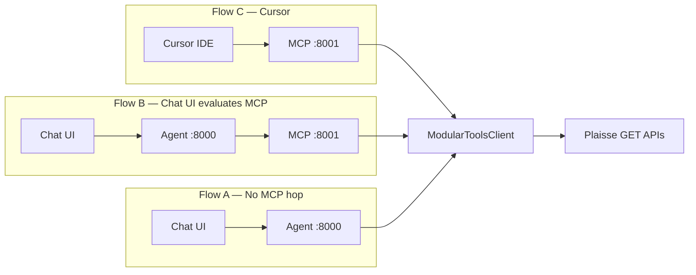
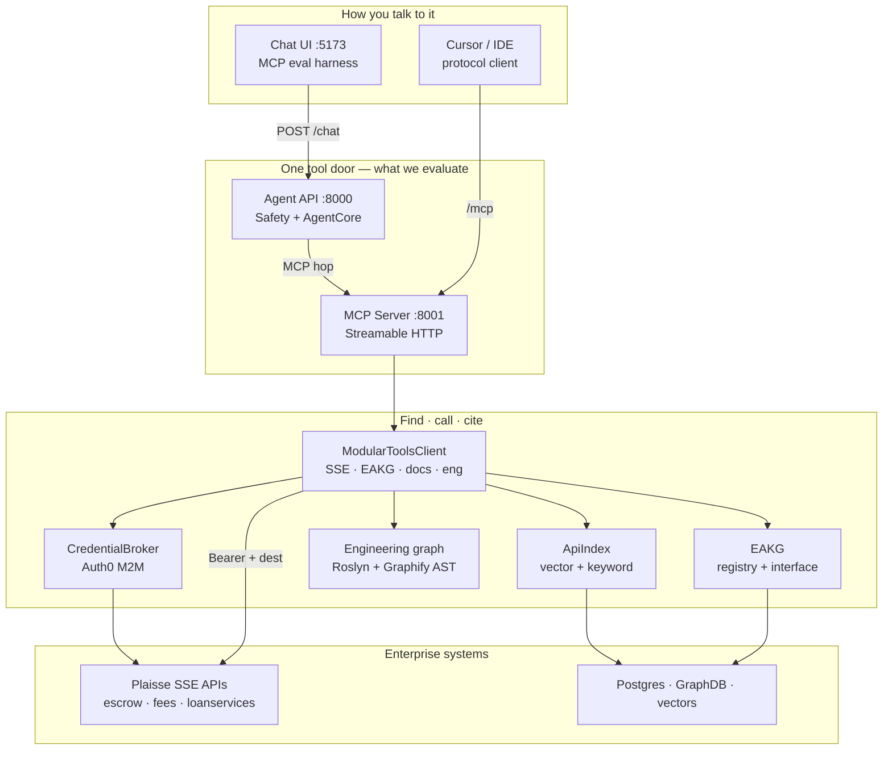

# LoanOps — Current State & Possible Future

> **Audience:** stakeholders, demos, new joiners  
> **Tone:** plain language  
> **Status:** working internal prototype  
> **Architecture visuals:** [Lucid — LoanOps-Agent Runtime Architecture](https://lucid.app/lucidchart/214feeb3-4a57-4947-b742-38e660794ada/edit?invitationId=inv_2762b1f0-d514-4b3f-8209-6b9a048b0edf&page=fzdJNN-SrbJ0#)  
> **Companion docs:** [`09-loanops-one-pager.md`](09-loanops-one-pager.md) · [`ARCHITECTURE.md`](../ARCHITECTURE.md) · [`PHASE_STATUS.md`](PHASE_STATUS.md)

---

## At a glance

**LoanOps** is an **internal MCP platform** — a shared tool room over Plaisse APIs, EAKG, and docs.

You ask in plain English (Cursor or Chat UI). The system finds the right API or document, makes a **read-only** call when needed, and drafts an answer with **citations**.

**Why we build the Chat UI:** not as the main product surface first — so we can **evaluate MCP** the way a real chat client would: tool choice, grounding, refusals, latency, and citations. Cursor proves the protocol; Chat UI stresses the same MCP door under an agent turn loop.

| It is | It is not |
| --- | --- |
| MCP-first platform (tools on `:8001`) | A public borrower chatbot |
| Chat UI = **MCP evaluation / harness client** | Chat UI = finished end-user product (yet) |
| Cursor + Chat UI share one tool room | Locked to one job title (e.g. care rep only) |
| Citation-grounded and audit-logged | Allowed to post payments or start plans (v1) |

---

## Table of contents

1. [What the app does](#1-what-the-app-does)
2. [Current state](#2-current-state)
3. [How people use it today](#3-how-people-use-it-today)
4. [Connected applications & links](#4-connected-applications--links)
5. [Possible future state](#5-possible-future-state)
6. [Architecture picture](#6-architecture-picture)
7. [Lucid chart map](#7-lucid-chart-map)
8. [Where to go next](#8-where-to-go-next)

---

## 1. What the app does

Think of LoanOps as a **smart librarian + phone book for APIs**.

```text
  Ask in plain English
           │
           ▼
  ┌────────────────────────────┐
  │ 1. Find the right API/doc  │  ← EAKG + OpenAPI + docs search
  │ 2. Call read-only tools    │  ← Plaisse GET APIs only
  │ 3. Draft a cited answer    │  ← policy: / tool: citations
  └────────────────────────────┘
           │
           ▼
     Human reviews before use
```

**Four steps on every serious answer**

1. **Discover** — which capability or OpenAPI operation fits the question  
2. **Search docs** — SOPs / policy when the question needs written guidance  
3. **Call** — live Plaisse REST (GET only), with Auth0 M2M credentials  
4. **Cite** — every factual claim tagged `policy:` or `tool:`

---

## 2. Current state

> One architecture today:  
> **clients → MCP → tools → catalog / knowledge graph / eng graph → Plaisse GET**  
> Auth in = shared MCP bearer · Auth out = Auth0 M2M for Plaisse

### What we are evaluating

| Thing under test | How we exercise it |
| --- | --- |
| **MCP server (`:8001`)** | Cursor (direct) + Chat UI → Agent → MCP hop |
| Tool discovery & search | `search_sse_apis`, capability tools, ApiIndex |
| Live GET invoke | `call_sse_api` → Plaisse via Auth0 M2M |
| Grounded chat quality | Agent turn: citations, refuse/escalate, safety, audit |
| Offline quality gate | Golden / eval runner (CI) — separate from the UI harness |

### What works now

| Piece | Status | Plain meaning |
| --- | --- | --- |
| MCP server (`:8001`) | Working — **thing we evaluate** | Shared tool room for Cursor and Chat UI |
| Web chat UI (`:5173`) | In progress / harness | Built so we can **evaluate MCP** via full chat turns |
| Agent API (`:8000`) | Working | Safety → intent → LLM + MCP tools → citations → audit |
| Live Plaisse GET APIs | Working (dev) | Escrow, Fees, Loan Services (+ Core Components in registry) |
| EAKG (capability knowledge graph) | Working; governance partial | Apps, APIs, relationships; review UI still thin |
| ApiIndex | Shipped | Vector + keyword search over API operations |
| Engineering graph | Built | `describe_application` / `search_code` from Roslyn + Graphify AST |
| Auth | Partial | MCP bearer in; Auth0 M2M out. Full user OBO still open |
| Mutating business actions | Blocked | No payments, plan starts, or POST/PUT via tools |
| Eval / quality gate | Exists | Golden set + thresholds (CI); Chat UI = interactive MCP eval |
| Full cloud production | Not daily path | Same code can swap to cloud via env; local/dev is home today |

### Three ways to talk to it

| Flow | Who | Path | Role |
| --- | --- | --- | --- |
| **C** | Engineer in Cursor | Cursor → MCP `:8001` → tools | Protocol / tool proof |
| **B** | Chat UI via MCP | UI → Agent `:8000` → MCP → tools | **MCP eval harness** (why we build the UI) |
| **A** | Chat UI without MCP | UI → Agent → tools in-process | Demo / rollback when `:8001` is down |



---

## 3. How people use it today

| Area | Example ask | What you learn about MCP |
| --- | --- | --- |
| **Loan / servicing facts** | “What is the status of loan X?” | Did search + GET pick the right op? Citations `tool:`? |
| **Policy / SOP answers** | “What does policy say about forbearance?” | Docs tool + `policy:` grounding |
| **API discovery** | “Which API returns borrower summary?” | Catalog / ApiIndex / EAKG quality |
| **App understanding** | “What does Escrow expose?” | `describe_application` over eng graph |
| **Code navigation** | “Where is this facade?” | `search_code` usefulness |
| **Impact / providers** | “Who provides capability X?” | EAKG tools: search / find / impact |
| **Refusal / escalate** | Out-of-scope or risky asks | MCP + agent policy still refuse safely |
| **Audit sampling** | “What did the agent use?” | Trace of MCP tool calls in audit JSONL |

### Explicitly out of scope (v1)

- Borrower-facing channels (public chat, voice, email)  
- Rate quotes, APR advice, refinance recommendations  
- Mutating actions (payments, holds, plan starts)  
- Licensed legal, tax, or financial advice  

---

## 4. Connected applications & links

### Plaisse apps in the EAKG registry (dev)

| Application | Source repo | Dev API |
| --- | --- | --- |
| **Core Components** | [CoreComponents.git](https://gitlab.pnmac.com/servicing/plaisse/applications/corecomponents/CoreComponents.git) | [corecomponentsapi-plaisse-dev.pnmac.com](https://corecomponentsapi-plaisse-dev.pnmac.com) |
| **Escrow Manager** | [escrow.git](https://gitlab.pnmac.com/servicing/plaisse/applications/escrow.git) | [escrowapi.dev.pennymac.plaisse.com](https://escrowapi.dev.pennymac.plaisse.com) |
| **Fees** | [Fees.git](https://gitlab.pnmac.com/servicing/plaisse/applications/fees/Fees.git) | [feesapi.dev.pennymac.plaisse.com](https://feesapi.dev.pennymac.plaisse.com) |
| **Loan Services** | [LoanServices.git](https://gitlab.pnmac.com/servicing/plaisse/applications/LoanServices.git) | [loanservicesapi.dev.pennymac.plaisse.com](https://loanservicesapi.dev.pennymac.plaisse.com) · swagger `/swagger/1.0/swagger.json` |

> Lucid labels the live SSE group as **escrowapi / feesapi / loanservicesapi**.

### LoanOps local surfaces

| Surface | Address |
| --- | --- |
| Web UI | http://localhost:5173 |
| Agent API | http://localhost:8000 — `/chat`, `/health` |
| MCP | http://127.0.0.1:8001/mcp |
| Runtime architecture (Lucid) | [Open chart](https://lucid.app/lucidchart/214feeb3-4a57-4947-b742-38e660794ada/edit?invitationId=inv_2762b1f0-d514-4b3f-8209-6b9a048b0edf&page=fzdJNN-SrbJ0#) |

> Some API hosts need VPN + Auth0. A bare browser open may return 401 outside the running stack.

---

## 5. Possible future state

Same platform — wider reach, stronger safety, more apps.

| Direction | What changes |
| --- | --- |
| **MCP proven under chat load** | Chat UI + golden eval show tool quality is good enough to trust |
| **More Plaisse apps** | Onboard repo #5+ into EAKG → more searchable, callable GETs |
| **Stronger auth** | Real user OBO + permission checks at invoke time |
| **Human review UI** | Approve / publish capability edges without CLI-only review |
| **UI beyond harness** | After MCP eval passes bar, Chat UI can become a real internal client |
| **Richer knowledge** | Confluence SOPs + GraphRAG communities in every grounded chat |
| **Broader roles** | PM / ops / compliance scopes via `AGENT_ROLE` |
| **Optional mutations (later)** | Only after explicit policy + eval approval — never the default |
| **Cloud deploy** | Same Python codebase on AWS / Bedrock via env swap |
| **Formal ARD** | Platform decision after Cursor + Chat-UI MCP proof |

### North star

> **EAKG fills the tools → one MCP door → Cursor and Chat UI (eval client) share that door → only allow-listed GET calls to Plaisse.**

### Current → possible (side by side)

| Theme | Now | Possible |
| --- | --- | --- |
| Why Chat UI exists | Evaluate / stress-test MCP | Optional: real internal chat client |
| Clients | Cursor + Chat UI harness | Proven multi-client MCP platform |
| Apps wired | 4 Plaisse apps (dev) | Broader enterprise catalog |
| Auth | Shared bearer + M2M | Per-user OBO + fine permissions |
| Knowledge | APIs + eng graph + docs path | SOPs + GraphRAG fully in the loop |
| Actions | Read-only | Read-only by default; mutations gated |
| Ops | Local / hybrid prototype | Cloud deploy + hardened eval gate |

---

## 6. Architecture picture



---

## 7. Lucid chart map

Full document: **[LoanOps-Agent Runtime Architecture](https://lucid.app/lucidchart/214feeb3-4a57-4947-b742-38e660794ada/edit?invitationId=inv_2762b1f0-d514-4b3f-8209-6b9a048b0edf&page=fzdJNN-SrbJ0#)** (13 pages)

| Page | Title | What you’ll see |
| ---: | --- | --- |
| 1 | Runtime overview | End-to-end boxes: UI, Cursor, Agent, MCP, tools, Plaisse |
| 2 | Chat turn flow | One message from UI through safety, tools, citations, audit |
| 3 | MCP + tools | Clients → auth → scopes → GET-only → tool families |
| 4 | SSE live invoke | Search → CredentialBroker → Auth0 → Plaisse GET |
| 5 | Knowledge map | EAKG, ApiIndex, docs, GraphRAG, engineering KG |
| 6–13 | Deeper paths | EAKG sync, index, GraphRAG, eval, related flows |

---

## 8. Where to go next

| If you want… | Open this |
| --- | --- |
| Full PPT + PDF guide (no code needed) | [`../presentations/loanops-overview/`](../presentations/loanops-overview/) — `LoanOps-Complete-Guide.*` |
| 60-second pitch | [`09-loanops-one-pager.md`](09-loanops-one-pager.md) |
| Living architecture | [`../ARCHITECTURE.md`](../ARCHITECTURE.md) |
| Every runtime / ops flow | [`FLOWS.md`](FLOWS.md) |
| Build / phase checklist | [`PHASE_STATUS.md`](PHASE_STATUS.md) |
| Full project brief | [`01-servicing-agent-prompts.md`](01-servicing-agent-prompts.md) |
| Settled decisions | [`../decisions.md`](../decisions.md) |
| Visual walkthrough | [Lucid chart](https://lucid.app/lucidchart/214feeb3-4a57-4947-b742-38e660794ada/edit?invitationId=inv_2762b1f0-d514-4b3f-8209-6b9a048b0edf&page=fzdJNN-SrbJ0#) |

---

*LoanOps · internal citation-grounded AI platform · ADR-021 audience: any enterprise role*
